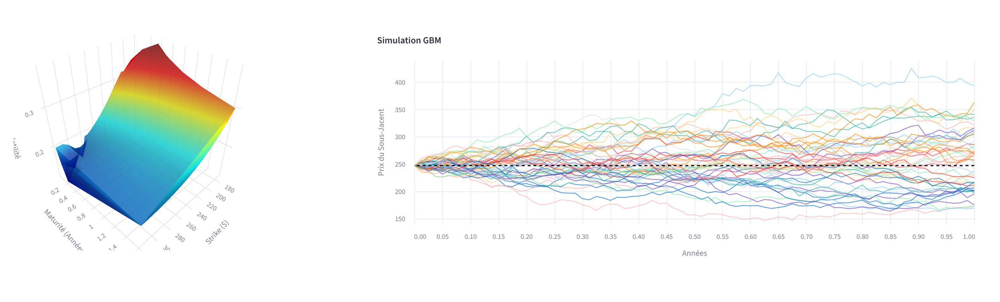
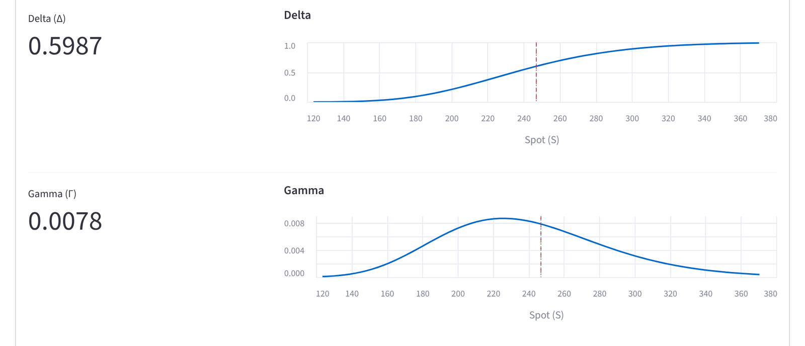
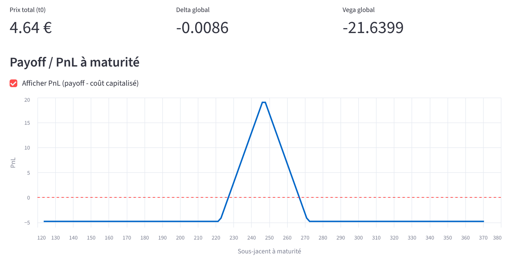
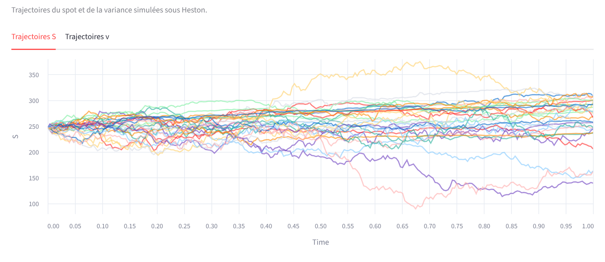
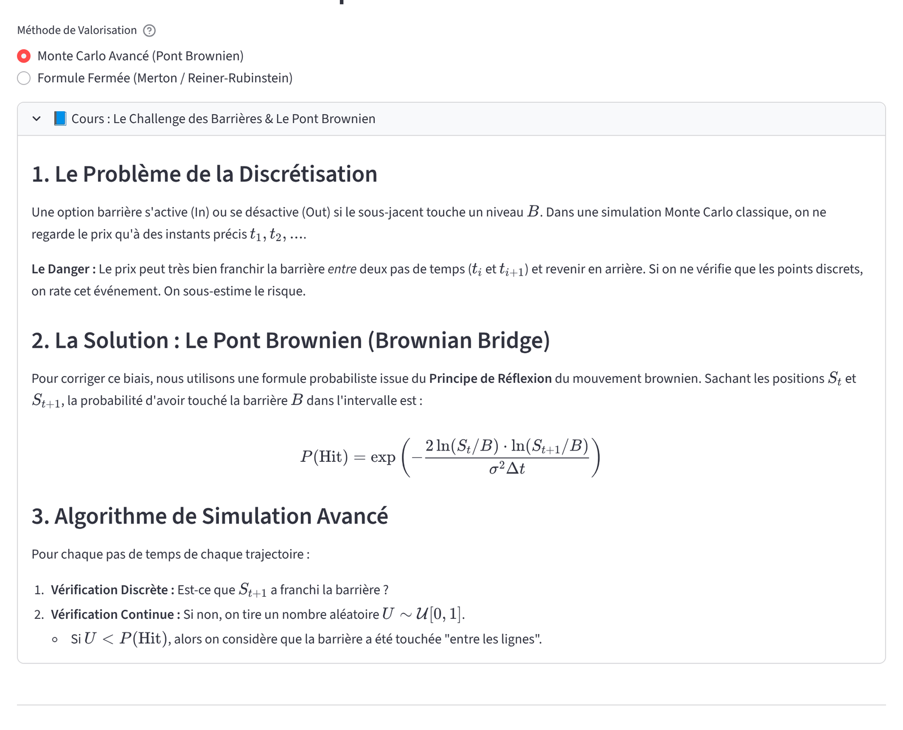
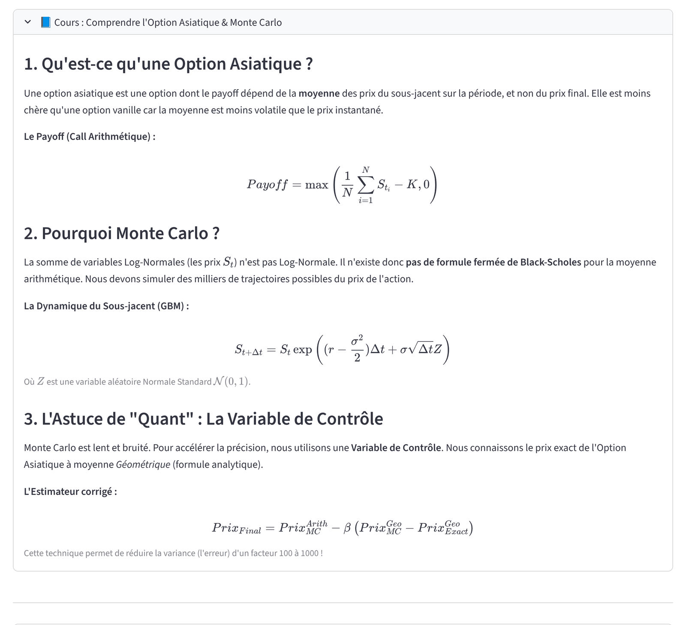
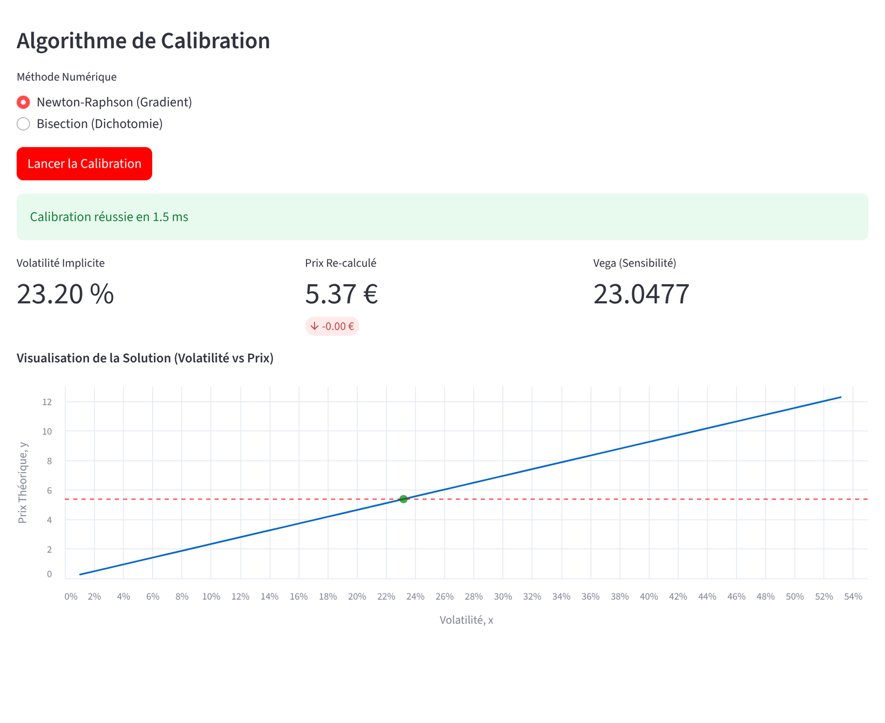

<h1 align="center">Pricing de produits dérivés</h1>

<p align="center">
  Projet du cours de pricing de produits dérivés, ENSAI<br>
  Antonin Meudic et Tom O'Connor
</p>

<p align="center">
  
  
  
</p>

<p align="center">
  
</p>

Une application Streamlit qui price une quinzaine de produits (taux, actions, options exotiques, produits structurés), calcule leurs sensibilités, calibre la volatilité implicite sur des prix de marché et construit la surface de volatilité.

Au départ c'était un projet de cours. On l'a poussé un peu plus loin pour qu'il serve aussi à apprendre : chaque produit est accompagné d'un petit cours intégré (intuition, hypothèses, formules utilisées dans le code, exemple chiffré) et de graphiques qui montrent ce que fait le modèle.

## Produits et méthodes

| Produit | Méthodes | Sensibilités |
|---|---|---|
| Obligation | Actualisation des flux, courbe US Treasury (FRED) + spread de crédit | |
| Swap de taux | Taux au pair, jambes fixe et variable | DV01, convexité, carry |
| Future sur action | Coût de portage, $F_0 = S_0 e^{(r-q)T}$ | |
| Option européenne | Black-Scholes, Monte Carlo, Heston | 5 grecques (analytiques ou par bump) |
| Option américaine | Arbre binomial CRR, Longstaff-Schwartz | Différences finies |
| Option asiatique | Monte Carlo avec variable de contrôle géométrique | Différences finies |
| Option barrière | Monte Carlo avec pont brownien, formule fermée de Reiner-Rubinstein | Différences finies |
| Produits structurés | Assemblage de jambes, stratégies prêtes à l'emploi (straddle, butterfly, spreads) | Delta, vega, payoff, PnL |
| Volatilité implicite | Newton-Raphson, dichotomie, surface $\sigma_{impl}(K,T)$ en 3D | |

## Le côté pédagogique

L'interface est pensée pour quelqu'un qui découvre le pricing. On ne voulait pas seulement afficher un prix, mais montrer d'où il vient. Par exemple, la page des barrières explique pourquoi un Monte Carlo à pas discrets rate des franchissements de barrière et comment le pont brownien corrige ce biais. La formule fermée y est décomposée en briques (vanille, option « reflet ») avec le tableau des combinaisons selon la position du strike.

<p align="center">
  
</p>

On retrouve la même logique ailleurs : pourquoi Heston ne donne pas le même prix que Black-Scholes à volatilité « moyenne » égale, pourquoi l'option asiatique arithmétique n'a pas de formule fermée, comment lire les grecques en fonction du spot, ou comment un butterfly se construit jambe par jambe.

<table>
  <tr>
    <td width="50%"></td>
    <td width="50%"></td>
  </tr>
  <tr>
    <td align="center"><sub>Grecques Black-Scholes en fonction du spot</sub></td>
    <td align="center"><sub>PnL d'un butterfly construit dans le builder</sub></td>
  </tr>
</table>

<details>
<summary>Plus de captures</summary>
<br>
<p align="center">
  <br><br>
  <br><br>
  <br><br>
  <br><br>
  
</p>
</details>

## Vérifications

On a recoupé les pricers entre eux et avec des valeurs publiées :

- Black-Scholes : parité call-put, et grecques analytiques identiques aux différences finies ;
- Heston avec une vol-of-vol quasi nulle : on retombe sur le prix Black-Scholes, à l'erreur Monte Carlo près ;
- put américain de l'article de Longstaff et Schwartz (2001) : 4.478 publié, 4.49 avec l'arbre CRR, 4.45 avec notre LSM ;
- barrières : la formule fermée redonne les valeurs de référence de Haug, et le Monte Carlo avec pont brownien tombe à environ 1 % de la formule fermée.

## Lancer l'application

```bash
pip install -r requirements.txt
streamlit run main_app.py
```

Les données viennent de Yahoo Finance (spots, historiques, chaînes d'options) et de FRED (courbe des taux US), il faut donc une connexion internet. La [notice utilisateur](Notice_Utilisateur___Pricing.pdf) détaille chaque page.

```
main_app.py           interface Streamlit (4 pages)
src/instruments/      obligation, swap, future, options, produit structuré
src/models/           Black-Scholes, Monte Carlo, Heston, CRR, LSM, asiatique, barrière
src/market_data/      données Yahoo / FRED, volatilité implicite, surface
src/utils/            paramètres communs
```

## Limites

Les modèles restent ceux d'un cours : une seule courbe de taux, un spread de crédit fixe par catégorie, une volatilité implicite calculée en européen alors que les options US cotées sont américaines, et des données Yahoo parfois incomplètes (prix figés, strikes sans volume) qui peuvent bruiter la surface.
